# CompanyIQ — AI-Powered Company Intelligence Platform

<p align="center">
  
</p>

<p align="center">
  <a href="https://nodejs.org"></a>
  <a href="https://expressjs.com"></a>
  <a href="https://www.mongodb.com"></a>
  <a href="https://ai.google.dev"></a>
  <a href="https://jwt.io"></a>
  <a href="https://swagger.io"></a>
  <a href="https://jestjs.io"></a>
  <a href="LICENSE"></a>
</p>

---

## Executive Summary

**CompanyIQ Backend** is a production-ready, evidence-backed REST API engineered to eliminate workplace research fragmentation. Built with Node.js, Express, and MongoDB Atlas, it serves as the central data and computation engine for the CompanyIQ ecosystem.

The backend unifies multi-registry corporate intelligence (India MCA, UK Companies House, OpenCorporates, Wikidata), aggregates verified employee signals, calculates deterministic multi-factor **Career Fit** matching, models transient career trade-offs through an isolated **What-If Simulator**, and runs a hallucination-defended **Retrieval-Augmented Generation (RAG)** Q&A pipeline powered by **Google Gemini**.

---

## Table of Contents

- [Core Architectural Philosophy](#core-architectural-philosophy)
- [System Architecture](#system-architecture)
- [Key Features](#key-features)
- [Technology Stack](#technology-stack)
- [Project Directory Structure](#project-directory-structure)
- [API Documentation](#api-documentation)
  - [Authentication & Identity](#1-authentication--identity-apiv1auth)
  - [Company Intelligence & Registry](#2-company-intelligence--registry-apiv1companies)
  - [Verified Live Jobs & Careers](#3-verified-live-jobs--careers-apiv1jobs--apiv1companiesidjobs)
  - [Career DNA Profile](#4-career-dna-profile-apiv1career-dna)
  - [Career Fit Scoring](#5-career-fit-scoring-apiv1career-fit)
  - [Company Comparison](#6-company-comparison-apiv1comparisons)
  - [What-If Career Simulator](#7-what-if-career-simulator-apiv1scenarios)
  - [Grounded AI Q&A Engine](#8-grounded-ai-qa-engine-apiv1ai)
  - [Overview Dashboard](#9-overview-dashboard-apiv1dashboard)
  - [Saved Companies Shortlist](#10-saved-companies-shortlist-apiv1saved-companies)
  - [Watchlist & Freshness Alerts](#11-watchlist--freshness-alerts-apiv1alerts--apiv1watchlist)
  - [Research Activity History](#12-research-activity-history-apiv1history)
  - [User Settings & Data Management](#13-user-settings--data-management-apiv1settings)
  - [System Health & Cloud Probes](#14-system-health--cloud-probes-health--apiv1health)
- [Installation & Setup](#installation--setup)
- [Environment Configuration](#environment-configuration)
- [Running the Application](#running-the-application)
- [Frontend Integration](#frontend-integration)
- [Security & Production Hardening](#security--production-hardening)
- [Future Roadmap](#future-roadmap)
- [Author & Acknowledgments](#author--acknowledgments)

---

## Core Architectural Philosophy

CompanyIQ is constructed around five strict domain engineering principles:

1. **Company Intelligence $\neq$ Career Fit**:
   - **Company Intelligence**: Evaluates what empirical evidence says about an organization (e.g., compensation benchmark, leadership rating, work-life balance).
   - **Career Fit**: Computes how well that company matches an individual's personal Career DNA priorities.
   - Adjusting personal career priorities **never mutates or biases the underlying company intelligence score**.
2. **Missing Information $\neq$ Zero**:
   - Lack of verifiable data on a specific metric (e.g., promotion velocity) returns `score: null` with status `INSUFFICIENT DATA`. It is **never penalized as a score of zero**.
3. **Traceable Evidence & Source Provenance**:
   - Every metric, claim, and AI answer links directly to verified `sourceIds` with freshness timestamps, official registry metadata, and conflict flags (`CONFLICTING`, `STALE`).
4. **Grounded AI Hallucination Defense (RAG)**:
   - LLM generation prompts are strictly grounded in loaded corporate evidence. When evidence is unavailable, the AI explicitly cites data limits rather than hallucinating answers.
5. **What-If Simulation Isolation**:
   - Career trade-off scenarios run in a sandbox memory model without mutating saved user records.

---

## System Architecture

The backend follows a strict **Controller-Service-Repository** pattern with dedicated middleware pipelines for security, validation, and error propagation:

```mermaid
flowchart TD
    Client["CompanyIQ Web Client / Mobile / API Consumer"]
    
    subgraph Edge ["Express Middleware Pipeline"]
        Helmet["Helmet (HTTP Security Headers)"]
        Cors["CORS (Origin Whitelist)"]
        RateLimit["Express Rate Limiter"]
        Parser["JSON & URL Parsers (1MB limit)"]
        Morgan["Morgan (Request Logger)"]
    end

    subgraph Routing ["Routing Layer (/api/v1)"]
        AuthRoutes["/auth"]
        CompanyRoutes["/companies"]
        JobRoutes["/jobs"]
        CareerRoutes["/career-dna & /career-fit"]
        CompareRoutes["/comparisons & /scenarios"]
        AIRoutes["/ai"]
        HealthRoutes["/health"]
    end

    subgraph AuthSecurity ["Auth & Validation Guards"]
        JWTGuard["JWT Token Guard (Bearer)"]
        GoogleGuard["Google OAuth 2.0 (GIS / JWKS)"]
        Validator["express-validator Rules"]
    end

    subgraph Controllers ["Controller Layer"]
        AuthController["authController"]
        CompanyController["companyController"]
        CareerController["careerController"]
        ComparisonController["comparisonController"]
        AIController["aiController"]
        JobController["jobController"]
    end

    subgraph Services ["Business Logic Services"]
        AuthService["authService & googleAuthService"]
        ScoringService["scoringService (Deterministic Math)"]
        CareerService["careerService (8-Factor Weights)"]
        CompanyDiscovery["companyDiscoveryService (Multi-Registry)"]
        JobDiscovery["jobDiscoveryService (ATS Integration)"]
        AIService["aiService (Gemini RAG Pipeline)"]
    end

    subgraph External ["External Services & Registries"]
        GeminiAPI["Google Gemini 1.5 / 2.5 Flash API"]
        MCARegistry["India MCA Registry Provider"]
        CompaniesHouse["UK Companies House API"]
        OpenCorporates["OpenCorporates API"]
        Wikidata["Wikidata Public Knowledge Base"]
        ATSBoards["Greenhouse & Lever ATS Feeds"]
    end

    subgraph Storage ["Database Layer"]
        MongoDB[("MongoDB Atlas (Mongoose ODM)")]
        Cache[("Provider Cache (24h TTL)")]
    end

    Client --> Edge
    Edge --> Routing
    Routing --> AuthSecurity
    AuthSecurity --> Controllers
    Controllers --> Services
    Services --> MongoDB
    Services --> Cache
    Services --> External
    External -.-> Services
    Services --> Controllers
    Controllers -->|"Standardized Envelope { success, data, error }"| Client
```



---

## Key Features

### 1. Robust Authentication & Session Management
- **Dual JWT Architecture**: Issues short-lived access tokens (1 hour) alongside revocable refresh tokens (7 days).
- **Google OAuth 2.0 Integration**: Supports dual flows:
  - **Google Identity Services (GIS)**: Direct client-side credential verification using Google's public JWKS certificates via `google-auth-library`.
  - **Server Authorization Code Flow**: Redirect initialization (`GET /google`) and callback code exchange (`GET /google/callback`).
- **Account Linking Safeguards**: Prevents existing password-based accounts from being hijacked by unverified external OAuth payloads.
- **Bcrypt Password Security**: Uses 12-round salted cryptographic hashing.

### 2. Multi-Registry Company Discovery Engine
- **Pluggable Architecture**: Dynamically aggregates entity records from official and open registries:
  - **MCA India**: Ministry of Corporate Affairs CIN, ROC, and incorporation data.
  - **UK Companies House**: Company numbers, filing statuses, and registered addresses.
  - **Wikidata**: Semantic knowledge graph identifiers and headquarters geocoding.
  - **OpenCorporates**: Global corporate registry indexing.
  - **Clearbit Discovery**: Domain normalization and branding assets.
- **Provider Cache**: Automatic 24-hour document cache to minimize upstream rate consumption and guarantee sub-100ms response times.

### 3. Verified Live Job & Career Discovery
- **ATS Board Ingestion**: Fetches active positions directly from company Greenhouse and Lever feeds.
- **Direct Portal Fallback**: Scrapes and standardizes careers data when third-party ATS feeds are unavailable.
- **Real-Time Synchronization**: On-demand `POST /companies/:id/jobs/refresh` allows instant catalog updates.

### 4. Career DNA & Mathematical Career Fit Engine
- **8-Factor Weighted Priorities**: Normalizes personal values across eight distinct dimensions:
  1. Base & Variable Compensation
  2. Work-Life Balance & Flexibility
  3. Career Acceleration & Promotion Velocity
  4. Work Culture & Psychological Safety
  5. Modern Technology Stack & Engineering Rigor
  6. Brand Prestige & Industry Visibility
  7. Job Security & Financial Runway
  8. Geographic Alignment & Remote Policies
- **Deterministic Fit Calculation**: Computes percentage compatibility mathematically against empirical company attributes without stochastic variability.

### 5. What-If Career Simulator
- **Transient Scenario Modeling**: Re-calculates and re-ranks company compatibility under hypothetical priority shifts (e.g., "+20% Salary vs -30% Work-Life Balance").
- **Zero Profile Mutation**: Keeps user's stored Career DNA intact while providing instant delta feedback.

### 6. Company Comparison Matrix
- **Side-by-Side Evaluation**: Simultaneously compares 2 or 3 organizations across categories, metrics, verified pros/cons, and employee sentiment.
- **Automatic Winner Highlights**: Programmatically flags category leaders and key trade-off considerations.

### 7. Grounded AI Engine (Google Gemini RAG)
- **Zero-Hallucination Guardrails**: Injects company metadata, review clusters, evidence claims, source provenance, and user priorities into structured system prompts via `groundedPromptBuilder.js`.
- **Deterministic Offline Fallback**: If LLM quota is exhausted or credentials are unset, automatically shifts to a rule-based synthesis engine to ensure unbroken uptime.
- **Threaded Conversations**: Saves session history in `AIConversation` and user research logs in `ResearchHistory`.

### 8. Enterprise Observability & Cloud Readiness
- **Multi-Level Health Checks**:
  - `/health` and `/api/v1/health`: Overall service uptime and MongoDB connection state.
  - `/api/v1/health/ready`: Kubernetes/Cloud readiness probe checking database availability.
  - `/api/v1/health/live`: Kubernetes/Cloud liveness probe checking event loop responsiveness.
- **Graceful Shutdown**: Intercepts `SIGTERM` and `SIGINT` to gracefully drain active HTTP connections and cleanly close MongoDB connection pools.

---

## Technology Stack

| Category | Technology | Purpose |
| :--- | :--- | :--- |
| **Runtime** | Node.js (v20+ LTS) | Asynchronous JavaScript runtime environment |
| **Framework** | Express.js (v4.21.2) | Fast, unopinionated HTTP REST API framework |
| **Database** | MongoDB & Mongoose (v8.12) | NoSQL document database with strict schema validation |
| **AI / LLM** | Google Gemini 1.5/2.5 Flash | Grounded RAG reasoning via `@google/genai` & `@google/generative-ai` |
| **Authentication** | JWT & Google Auth Library | Token rotation (`jsonwebtoken`) & Google OAuth 2.0 (`google-auth-library`) |
| **Password Hashing** | Bcrypt.js (v3.0.2) | Salted cryptographic password hashing |
| **Security** | Helmet (v8.0.0) | Secures HTTP headers against XSS, clickjacking, and sniffing |
| **Rate Limiting** | express-rate-limit (v7.5) | IP-based request rate throttling |
| **Validation** | express-validator (v7.2) | Declarative middleware for request body and query sanitization |
| **CORS** | cors (v2.8.5) | Domain origin whitelisting across dev and production |
| **Logging** | Morgan & Custom Logger | HTTP request logging with sanitized secret masking |
| **API Documentation**| Swagger UI Express (v5.0) | Interactive OpenAPI 3.0 documentation interface |
| **Testing** | Jest (v29.7) & Supertest (v7.0) | End-to-end HTTP integration and unit testing |

---

## Project Directory Structure

```text
h2backend/
├── docs/
│   ├── api-contract.md                  # Comprehensive REST API request/response specifications
│   └── backend-requirements.md          # Architectural specifications and domain rules
├── scripts/
│   ├── manageDemoAccount.js             # Utility to inspect and seed the demo account
│   ├── seed.js                          # Core seed script with flagship tech companies
│   ├── seedExpandedCompanies.js         # Comprehensive multi-sector corporate seeder
│   └── seedRealRegistryCompanies.js     # Real MCA and Wikidata corporate entity seeder
├── src/
│   ├── app.js                           # Express application assembly, middleware, and route registration
│   ├── server.js                        # HTTP server listener and graceful shutdown handlers
│   ├── config/
│   │   ├── ai.js                        # Google Gemini client initialization and health probe
│   │   ├── db.js                        # Mongoose connection pool management
│   │   └── env.js                       # Environment variable validation and defaults
│   ├── constants/
│   │   └── index.js                     # System constants, category definitions, and default weights
│   ├── controllers/
│   │   ├── aiController.js              # Grounded Q&A and conversation thread handlers
│   │   ├── alertController.js           # Watchlist and notification endpoints
│   │   ├── authController.js            # Register, login, refresh, and Google OAuth handlers
│   │   ├── careerController.js          # Career DNA and Career Fit calculation handlers
│   │   ├── companyController.js         # Company search, filter, details, and submission handlers
│   │   ├── comparisonController.js       # Side-by-side comparison calculation and storage
│   │   ├── dashboardController.js        # Overview dashboard aggregator
│   │   ├── historyController.js          # User research activity history handlers
│   │   ├── jobController.js              # Real-time job discovery and career portal handlers
│   │   ├── savedCompanyController.js     # User company bookmarking handlers
│   │   ├── scenarioController.js         # What-If Simulator calculation and saving
│   │   └── settingsController.js         # User profile, privacy, and data export handlers
│   ├── docs/
│   │   └── swagger.json                 # OpenAPI 3.0 specification definition
│   ├── middleware/
│   │   ├── auth.js                      # JWT authentication (`authenticate`, `optionalAuth`, `requireAdmin`)
│   │   ├── errorHandler.js              # Global centralized error handler and sanitizer
│   │   ├── notFound.js                  # Standardized 404 response handler
│   │   └── validate.js                  # express-validator execution wrapper
│   ├── models/
│   │   ├── AIConversation.js            # Threaded chat history with grounded contexts
│   │   ├── Alert.js                     # Watchlist notifications and metric shifts
│   │   ├── CareerDNA.js                 # 8-factor personal weighted preferences
│   │   ├── Company.js                   # Corporate entity profiles, registries, and meta
│   │   ├── CompanyIntelligence.js       # Category scores, praises, risks, and trends
│   │   ├── CompanySubmission.js         # User-submitted company verification pipeline
│   │   ├── ComparisonScenario.js        # Saved comparison matrices and What-If models
│   │   ├── Evidence.js                  # Verifiable claims linked to source references
│   │   ├── Job.js                       # Verified positions with ATS source tracking
│   │   ├── ProviderCache.js             # 24-hour cache for external registry API calls
│   │   ├── ResearchHistory.js           # Chronological research trail grouped by date
│   │   ├── ReviewAggregate.js           # Platform ratings, sentiment distributions, and themes
│   │   ├── SavedCompany.js              # User-shortlisted corporate entities
│   │   ├── Source.js                    # Attributed sources, URLs, and reliability scores
│   │   └── User.js                      # User identities, hashed passwords, and preferences
│   ├── prompts/
│   │   └── groundedPromptBuilder.js     # Strict context grounding builder for Gemini LLM
│   ├── routes/
│   │   ├── ai.js                        # Grounded Q&A routes
│   │   ├── alerts.js                    # User notification routes
│   │   ├── auth.js                      # Authentication & Google OAuth routes
│   │   ├── careerDna.js                 # Personal Career DNA routes
│   │   ├── careerFit.js                 # Match score routes
│   │   ├── companies.js                 # Company intelligence routes
│   │   ├── comparisons.js               # Comparison routes
│   │   ├── dashboard.js                 # Main dashboard routes
│   │   ├── health.js                    # Health and probe routes
│   │   ├── history.js                   # Research history routes
│   │   ├── jobs.js                      # Job listing routes
│   │   ├── savedCompanies.js            # Saved company routes
│   │   ├── scenarios.js                 # What-If Simulator routes
│   │   ├── settings.js                  # User settings and data export routes
│   │   └── watchlist.js                 # Watchlist management routes
│   ├── services/
│   │   ├── aiService.js                 # Gemini RAG pipeline with deterministic fallback
│   │   ├── alertService.js              # Watchlist monitoring logic
│   │   ├── authService.js               # User lifecycle and token rotation
│   │   ├── careerService.js             # Career DNA prioritization and Fit logic
│   │   ├── companyDiscoveryService.js   # Multi-registry orchestrator
│   │   ├── companyService.js            # Corporate intelligence data queries
│   │   ├── comparisonService.js         # Side-by-side comparison computation
│   │   ├── dashboardService.js          # Overview aggregation logic
│   │   ├── googleAuthService.js         # Google token verification and code exchange
│   │   ├── historyService.js            # Activity logging logic
│   │   ├── jobDiscoveryService.js       # Live ATS jobs orchestrator
│   │   ├── jobService.js                # Careers and openings data queries
│   │   ├── savedCompanyService.js       # Shortlist management logic
│   │   ├── scenarioService.js           # What-If calculation engine
│   │   ├── scoringService.js            # Deterministic math engine for company metrics
│   │   ├── settingsService.js           # Settings and data export logic
│   │   └── providers/                   # External registry & ATS API providers
│   │       ├── BaseCompanyProvider.js
│   │       ├── ClearbitDiscoveryProvider.js
│   │       ├── CompaniesHouseProvider.js
│   │       ├── DirectPortalJobProvider.js
│   │       ├── GreenhouseJobProvider.js
│   │       ├── LeverJobProvider.js
│   │       ├── McaIndiaRegistryProvider.js
│   │       ├── OpenCorporatesProvider.js
│   │       └── WikidataRegistryProvider.js
│   └── utils/
│       ├── apiResponse.js               # Standardized { success, data, error } envelope
│       ├── appError.js                  # Operational error class with HTTP status codes
│       ├── logger.js                    # Structured application logger with secret masking
│       ├── sanitizer.js                 # Sensitive credentials and tokens masking utility
│       ├── token.js                     # JWT signing and verification helpers
│       └── urlValidator.js              # URL sanitization and validation utility
├── tests/                               # Jest integration test suites
│   ├── ai.test.js
│   ├── api.test.js
│   ├── authProfessional.test.js
│   ├── dataAccuracyAudit.test.js
│   ├── googleAuth.test.js
│   ├── jobs.test.js
│   ├── linkAudit.test.js
│   ├── realCompanyDiscovery.test.js
│   └── whatifDynamic.test.js
├── .env.example                         # Environment variable template
├── package.json                         # Project dependencies and script declarations
└── README.md                            # Comprehensive backend documentation
```

---

## API Documentation

The backend exposes a clean REST API under the `/api/v1` prefix. Interactive Swagger documentation is accessible at **`http://localhost:5000/api-docs`**.

### 1. Authentication & Identity (`/api/v1/auth`)

| Method | Endpoint | Purpose | Auth Required |
| :--- | :--- | :--- | :--- |
| `POST` | `/api/v1/auth/register` | Register a new user with email and password | Public |
| `POST` | `/api/v1/auth/login` | Authenticate with credentials and receive JWT pair | Public |
| `GET` | `/api/v1/auth/google` | Initialize Google OAuth 2.0 authorization redirect | Public |
| `GET` | `/api/v1/auth/google/callback`| OAuth 2.0 authorization code exchange callback | Public |
| `POST` | `/api/v1/auth/google` | Authenticate using Google Identity Services ID token | Public |
| `POST` | `/api/v1/auth/demo` | Instant login with predefined demo credentials | Public |
| `GET` | `/api/v1/auth/me` | Fetch currently authenticated user profile | Bearer JWT |
| `POST` | `/api/v1/auth/refresh` | Rotate access token using valid refresh token | Public |
| `POST` | `/api/v1/auth/logout` | Revoke current user session | Bearer JWT |
| `POST` | `/api/v1/auth/forgot-password` | Request password reset token | Public |
| `POST` | `/api/v1/auth/reset-password` | Reset password using valid verification token | Public |

### 2. Company Intelligence & Registry (`/api/v1/companies`)

| Method | Endpoint | Purpose | Auth Required |
| :--- | :--- | :--- | :--- |
| `GET` | `/api/v1/companies` | Search, filter, and paginate company intelligence records | Optional |
| `GET` | `/api/v1/companies/suggestions`| Instant autocomplete search suggestions | Public |
| `POST` | `/api/v1/companies/submit` | Submit a new company for community/admin verification | Optional |
| `GET` | `/api/v1/companies/:id` | Fetch full company intelligence report by ID or slug | Optional |
| `GET` | `/api/v1/companies/:id/evidence`| Retrieve traceable evidence claims and review mentions | Optional |
| `GET` | `/api/v1/companies/:id/sources` | Retrieve attributed sources and provenance references | Optional |
| `GET` | `/api/v1/companies/:id/review-insights`| Fetch ratings, sentiment distribution, and themes | Optional |
| `GET` | `/api/v1/companies/admin/submissions`| List pending company verification requests | Admin |
| `PATCH` | `/api/v1/companies/admin/submissions/:id/verify`| Approve or reject community company submission | Admin |

### 3. Verified Live Jobs & Careers (`/api/v1/jobs` & `/api/v1/companies/:id/jobs`)

| Method | Endpoint | Purpose | Auth Required |
| :--- | :--- | :--- | :--- |
| `GET` | `/api/v1/jobs` | Query active jobs across companies with filters | Optional |
| `GET` | `/api/v1/jobs/:jobId` | Fetch individual verified job opening details | Optional |
| `GET` | `/api/v1/companies/:id/jobs` | List live job openings for a specific company | Optional |
| `GET` | `/api/v1/companies/:id/careers` | Summary of active departments, hiring velocity, and locations | Optional |
| `POST` | `/api/v1/companies/:id/jobs/refresh`| Force real-time refresh from ATS job feeds | Optional |

### 4. Career DNA Profile (`/api/v1/career-dna`)

| Method | Endpoint | Purpose | Auth Required |
| :--- | :--- | :--- | :--- |
| `GET` | `/api/v1/career-dna` | Retrieve user's 8-factor weighted career priorities | Bearer JWT |
| `POST` | `/api/v1/career-dna` | Create or replace user's Career DNA preferences | Bearer JWT |
| `PUT` | `/api/v1/career-dna` | Update user's Career DNA preferences | Bearer JWT |
| `DELETE` | `/api/v1/career-dna` | Reset Career DNA profile to system defaults | Bearer JWT |

### 5. Career Fit Scoring (`/api/v1/career-fit`)

| Method | Endpoint | Purpose | Auth Required |
| :--- | :--- | :--- | :--- |
| `GET` | `/api/v1/career-fit` | Compute personalized fit scores across all companies | Bearer JWT |
| `GET` | `/api/v1/career-fit/:companyId`| Calculate fit score for a specific company | Optional |

### 6. Company Comparison (`/api/v1/comparisons`)

| Method | Endpoint | Purpose | Auth Required |
| :--- | :--- | :--- | :--- |
| `POST` | `/api/v1/comparisons/calculate`| Compute side-by-side comparison matrix for 2–3 companies | Optional |
| `GET` | `/api/v1/comparisons` | Retrieve user's saved company comparisons | Bearer JWT |
| `POST` | `/api/v1/comparisons` | Save a side-by-side comparison matrix | Bearer JWT |
| `GET` | `/api/v1/comparisons/:id` | Retrieve saved comparison details by ID | Bearer JWT |
| `DELETE` | `/api/v1/comparisons/:id` | Delete saved comparison record | Bearer JWT |

### 7. What-If Career Simulator (`/api/v1/scenarios`)

| Method | Endpoint | Purpose | Auth Required |
| :--- | :--- | :--- | :--- |
| `POST` | `/api/v1/scenarios/calculate` | Calculate company re-ranking under transient priority weights | Optional |
| `POST` | `/api/v1/scenarios` | Save a What-If simulation scenario | Bearer JWT |
| `GET` | `/api/v1/scenarios` | Retrieve user's saved What-If scenarios | Bearer JWT |
| `GET` | `/api/v1/scenarios/:id` | Retrieve specific What-If scenario details | Bearer JWT |
| `DELETE` | `/api/v1/scenarios/:id` | Delete saved What-If scenario | Bearer JWT |

### 8. Grounded AI Q&A Engine (`/api/v1/ai`)

| Method | Endpoint | Purpose | Auth Required |
| :--- | :--- | :--- | :--- |
| `GET` | `/api/v1/ai/status` | Probe active AI provider status (Gemini model & health) | Public |
| `POST` | `/api/v1/ai/ask` | Ask grounded question about a company (Gemini RAG pipeline) | Optional |
| `GET` | `/api/v1/ai/threads` | Retrieve user's conversation threads | Optional |
| `GET` | `/api/v1/ai/threads/:id` | Retrieve specific conversation thread messages | Optional |

### 9. Overview Dashboard (`/api/v1/dashboard`)

| Method | Endpoint | Purpose | Auth Required |
| :--- | :--- | :--- | :--- |
| `GET` | `/api/v1/dashboard` | Aggregated dashboard data: top matches, activity, watchlist | Optional |

### 10. Saved Companies Shortlist (`/api/v1/saved-companies`)

| Method | Endpoint | Purpose | Auth Required |
| :--- | :--- | :--- | :--- |
| `GET` | `/api/v1/saved-companies` | Retrieve user's shortlisted companies | Bearer JWT |
| `POST` | `/api/v1/saved-companies/:companyId`| Add company to shortlist | Bearer JWT |
| `DELETE`| `/api/v1/saved-companies/:companyId`| Remove company from shortlist | Bearer JWT |

### 11. Watchlist & Freshness Alerts (`/api/v1/alerts` & `/api/v1/watchlist`)

| Method | Endpoint | Purpose | Auth Required |
| :--- | :--- | :--- | :--- |
| `GET` | `/api/v1/alerts` | Retrieve notifications and data freshness updates | Optional |
| `PATCH` | `/api/v1/alerts/:id/read` | Mark specific notification as read | Bearer JWT |
| `GET` | `/api/v1/watchlist` | Retrieve user's tracked companies watchlist | Bearer JWT |
| `POST` | `/api/v1/watchlist/:companyId`| Add company to tracked watchlist | Bearer JWT |
| `DELETE`| `/api/v1/watchlist/:companyId`| Remove company from tracked watchlist | Bearer JWT |

### 12. Research Activity History (`/api/v1/history`)

| Method | Endpoint | Purpose | Auth Required |
| :--- | :--- | :--- | :--- |
| `GET` | `/api/v1/history` | Retrieve chronological research history grouped by date | Bearer JWT |
| `POST` | `/api/v1/history` | Record a custom research interaction event | Bearer JWT |
| `DELETE`| `/api/v1/history` | Clear research activity history | Bearer JWT |

### 13. User Settings & Data Management (`/api/v1/settings`)

| Method | Endpoint | Purpose | Auth Required |
| :--- | :--- | :--- | :--- |
| `GET` | `/api/v1/settings` | Retrieve user account and research preferences | Bearer JWT |
| `PUT` | `/api/v1/settings` | Update user profile and research settings | Bearer JWT |
| `GET` | `/api/v1/settings/export` | Export all user data as portable JSON (GDPR compliance) | Bearer JWT |
| `DELETE`| `/api/v1/settings/history` | Purge all user research history records | Bearer JWT |
| `DELETE`| `/api/v1/settings/career-dna` | Purge user's Career DNA preferences | Bearer JWT |
| `DELETE`| `/api/v1/settings/saved-companies`| Purge all user shortlisted companies | Bearer JWT |

### 14. System Health & Cloud Probes (`/health` & `/api/v1/health`)

| Method | Endpoint | Purpose | Auth Required |
| :--- | :--- | :--- | :--- |
| `GET` | `/health` or `/api/v1/health` | Comprehensive health check and MongoDB connection state | Public |
| `GET` | `/api/v1/health/ready` | Kubernetes/Cloud readiness probe (checks DB dependency) | Public |
| `GET` | `/api/v1/health/live` | Kubernetes/Cloud liveness probe (checks event loop responsiveness) | Public |

---

## Installation & Setup

### Prerequisites
- **Node.js**: v20.0.0 or higher ([Download Node.js](https://nodejs.org/))
- **MongoDB**: Local MongoDB community server or [MongoDB Atlas](https://www.mongodb.com/cloud/atlas) cluster
- **npm**: v9.0.0 or higher

### Step 1: Clone the Repository
```bash
git clone https://github.com/hariomjaiswal12/CompanyIQ-AI-Powered-Company-Intelligence-Platform.git
cd CompanyIQ-AI-Powered-Company-Intelligence-Platform
```

### Step 2: Install Dependencies
```bash
npm install
```

### Step 3: Configure Environment Variables
Copy the template configuration file:
```bash
cp .env.example .env
```
Open `.env` and configure your MongoDB connection string and API keys (see [Environment Configuration](#environment-configuration)).

### Step 4: Seed the Database
Populate the database with initial company intelligence records and demo data:

```bash
# Seed primary tech companies (TCS, Infosys, Accenture, Microsoft, Google)
npm run seed

# Optional: Seed expanded multi-sector companies (Fintech, SaaS, Healthcare)
npm run seed:expanded

# Optional: Seed real registry companies with verified MCA / ROC records
npm run seed:real
```

Default seeded credentials for testing:
- **Email:** `hariom@example.com`
- **Password:** `Password123!`

---

## Environment Configuration

Configure the following variables in your `.env` file:

| Variable | Description | Required | Default / Example |
| :--- | :--- | :--- | :--- |
| `PORT` | HTTP port on which the Express server listens | No | `5000` |
| `NODE_ENV` | Runtime environment mode (`development`, `production`, `test`) | No | `development` |
| `MONGODB_URI` | MongoDB connection URI (Atlas string required in production) | **Yes** | `mongodb://127.0.0.1:27017/companyiq` |
| `DB_MAX_POOL_SIZE` | Maximum connection pool size for MongoDB | No | `25` |
| `JWT_ACCESS_SECRET` | Secret key for signing short-lived access tokens | **Yes** | *Cryptographically random 64-char string* |
| `JWT_REFRESH_SECRET`| Secret key for signing refresh tokens | **Yes** | *Cryptographically random 64-char string* |
| `JWT_ACCESS_EXPIRES_IN` | Access token lifespan | No | `1h` |
| `JWT_REFRESH_EXPIRES_IN`| Refresh token lifespan | No | `7d` |
| `FRONTEND_URL` | Comma-separated allowed CORS origins | No | `http://localhost:5173` |
| `RATE_LIMIT_WINDOW_MS` | Rate limiting sliding window in milliseconds | No | `900000` (15 minutes) |
| `RATE_LIMIT_MAX` | Max allowed requests per IP per window in production | No | `1000` |
| `AI_PROVIDER` | Selected AI inference provider (`gemini`) | No | `gemini` |
| `GEMINI_API_KEY` | Google Gemini API key ([Get a Gemini key](https://aistudio.google.com/)) | Optional | `your_gemini_api_key` |
| `GEMINI_MODEL` | Gemini model name | No | `gemini-1.5-flash` |
| `GOOGLE_CLIENT_ID` | Google OAuth 2.0 Web Client ID for token verification | Optional | `your_google_client_id.apps.googleusercontent.com` |
| `GOOGLE_CLIENT_SECRET` | Google OAuth 2.0 Client Secret (for code exchange) | Optional | `your_google_client_secret` |
| `GOOGLE_CALLBACK_URL` | OAuth redirect URI registered in Google Cloud Console | Optional | `http://localhost:5000/api/v1/auth/google/callback` |
| `OPENCORPORATES_API_TOKEN` | Optional OpenCorporates API key for global registry data | No | `your_opencorporates_token` |
| `COMPANIES_HOUSE_API_KEY` | Optional UK Companies House API key for UK corporate data | No | `your_companies_house_key` |
| `CACHE_TTL_HOURS` | Lifetime for external registry provider cache | No | `24` |
| `PROVIDER_TIMEOUT_MS` | Max wait time before timing out external provider requests | No | `4000` |

> [!NOTE]
> If `GEMINI_API_KEY` is omitted, CompanyIQ automatically engages its built-in deterministic rule synthesizer. The system operates gracefully without crashing or throwing 500 errors!

---

## Running the Application

### Development Mode (with Live Reload)
```bash
npm run dev
```
The server will start at `http://localhost:5000` with Nodemon watching for file modifications.

### Production Mode
```bash
npm start
```

### Health Check Verification
Verify that the service is running and connected to MongoDB:
```bash
curl http://localhost:5000/api/v1/health
```
Expected response:
```json
{
  "success": true,
  "status": "healthy",
  "database": "connected",
  "timestamp": "2026-11-03T10:20:00.000Z",
  "uptimeSeconds": 42,
  "service": "CompanyIQ Backend API",
  "version": "1.0.0"
}
```

### Interactive API Explorer
Open your browser and navigate to:
```text
http://localhost:5000/api-docs
```

### Executing the Test Suite
CompanyIQ includes comprehensive integration test suites verifying authentication, deterministic scoring, Google OAuth, live job boards, registry providers, and AI fallback:

```bash
npm test
```

---

## Frontend Integration

The CompanyIQ frontend is maintained as a separate single-page application built with React 19, TypeScript, Vite, and Tailwind CSS.

- **Frontend Repository**: [https://github.com/hariomjaiswal12/hackathon-1-Hariom-jaiswal-frontend](https://github.com/hariomjaiswal12/hackathon-1-Hariom-jaiswal-frontend)
- **Production Frontend**: [https://hackathon-2-hariom-jaiswal-frontend.vercel.app](https://hackathon-2-hariom-jaiswal-frontend.vercel.app)

### Communication Contract
The frontend communicates with this backend over HTTPS using a typed API client:
1. **Base URL**: Configured via `VITE_API_URL` pointing to `https://<backend-domain>/api/v1`.
2. **Authorization**: Sends `Authorization: Bearer <jwt_access_token>` in request headers for protected endpoints.
3. **Session Hydration**: On page load, `GET /api/v1/auth/me` validates the stored token and hydrates user state in `AppContext`.
4. **Google Sign-In**: The frontend renders the Google Identity Services button, acquires the Google signed ID token, and sends `{ credential }` to `POST /api/v1/auth/google`.
5. **Standardized Response Envelope**: All endpoints return responses formatted as:
   ```json
   {
     "success": true,
     "data": { ... },
     "message": "Optional descriptive status message"
   }
   ```
   Errors follow a structured format:
   ```json
   {
     "success": false,
     "error": {
       "code": "ERROR_CODE_IDENTIFIER",
       "message": "Human-readable explanation of error",
       "details": []
     }
   }
   ```

---

## Security & Production Hardening

- **HTTP Header Security**: Protected via `helmet` to mitigate cross-site scripting (XSS), MIME-type sniffing, and clickjacking attacks.
- **Strict CORS Protection**: Whitelists authorized frontend origins with automatic trailing-slash normalization.
- **Rate Limiting**: Throttles incoming client requests using `express-rate-limit` to prevent brute-force attacks on authentication endpoints.
- **Sanitized Logging**: All application logging passes through `sanitizer.js` to mask sensitive JWT tokens, passwords, and API keys.
- **SQL / NoSQL Injection Defense**: Uses Mongoose typed schemas and query sanitization to protect against operator injection attacks (`$gt`, `$ne`).
- **Input Validation**: Employs `express-validator` to strictly validate and sanitize incoming payloads before controller execution.
- **Safe Account Linking**: Disallows linking third-party OAuth providers to existing password accounts unless authenticated.
- **Graceful Process Management**: Handles `SIGINT` and `SIGTERM` signals, completing in-flight requests and cleanly closing database connections.

---

## Future Roadmap

- [ ] **Redis Distributed Cache**: Implement Redis for distributed session caching and rate-limit sharing across cluster instances.
- [ ] **Asynchronous Message Queue**: Integrate BullMQ or RabbitMQ for decoupled background job indexing and periodic registry scraping.
- [ ] **WebSocket Real-Time Updates**: Provide live push notifications for watchlist alerts and hiring velocity spikes using Socket.io.
- [ ] **GraphQL Gateway**: Provide a federated GraphQL endpoint alongside REST to enable client-driven query filtering.
- [ ] **Webhook Subscriptions**: Allow enterprise consumers to subscribe to company intelligence change events.

---

## Author & Acknowledgments

**Hariom Jaiswal**  
- **GitHub**: [@hariomjaiswal12](https://github.com/hariomjaiswal12)  
- **LinkedIn**: [Hariom Jaiswal](https://www.linkedin.com/in/hariom-jaiswal-82ba74328/)  

Developed as part of the **CompanyIQ** initiative — empowering students, developers, and professionals with transparent, evidence-backed workplace intelligence.

---

<p align="center">
  <sub>Built with precision, evidence, and mathematical integrity. Licensed under the ISC License.</sub>
</p>
