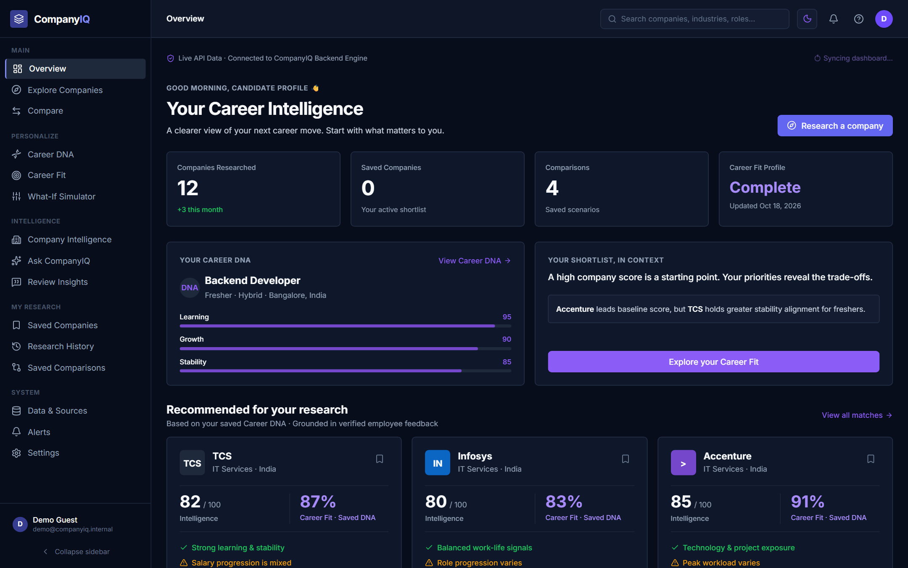
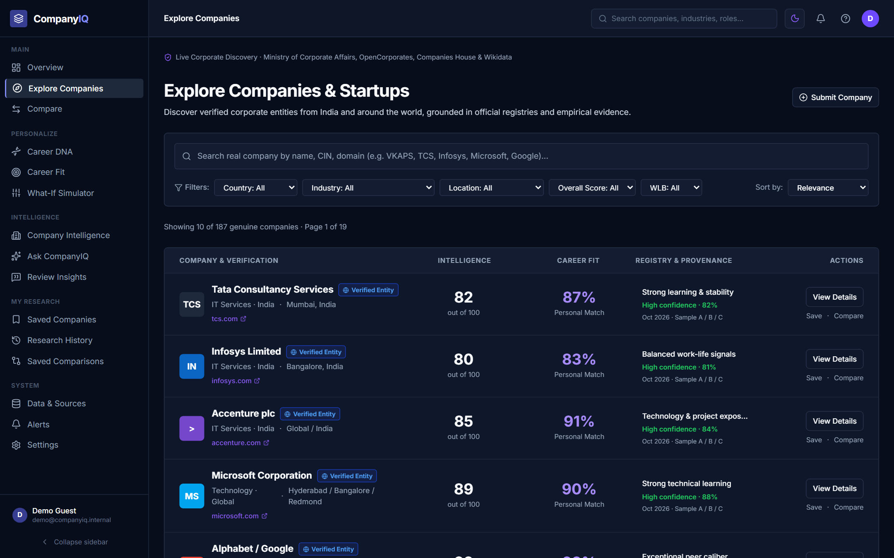
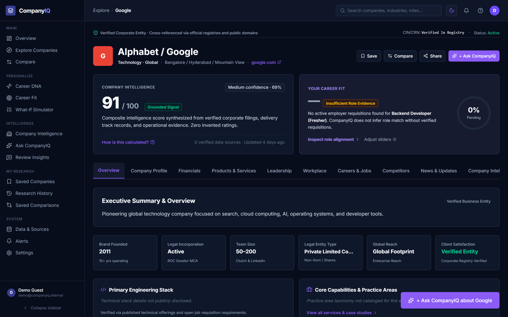
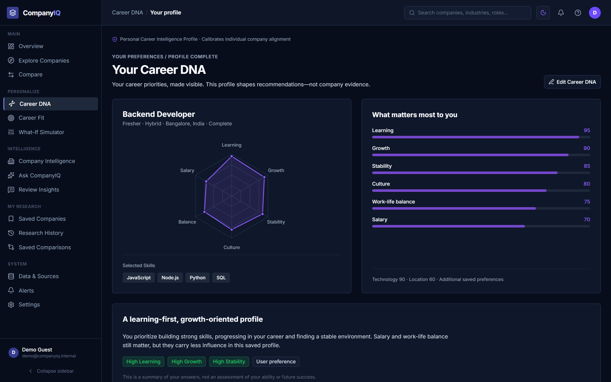
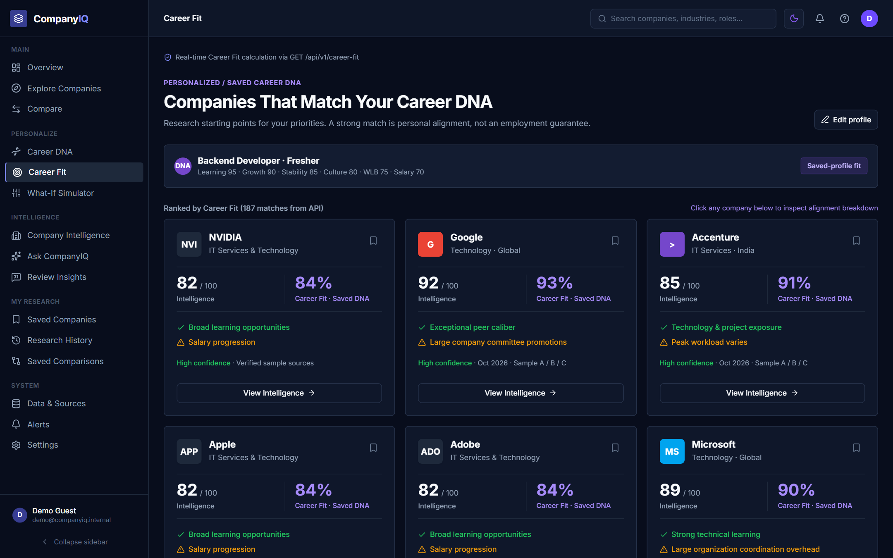
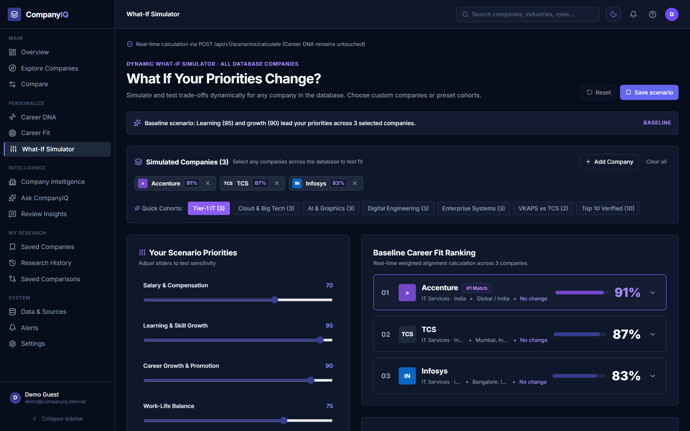
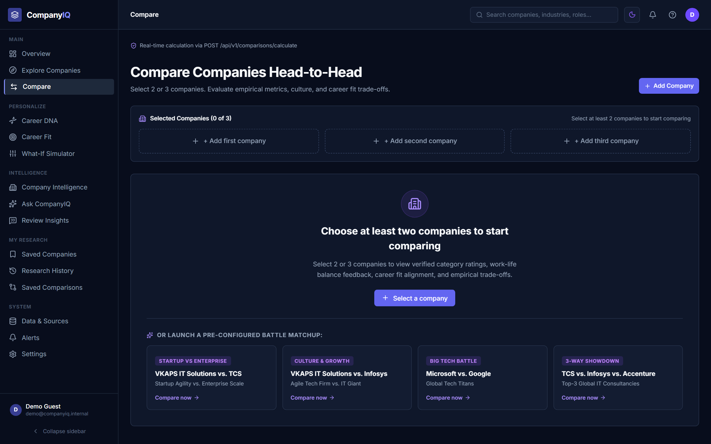
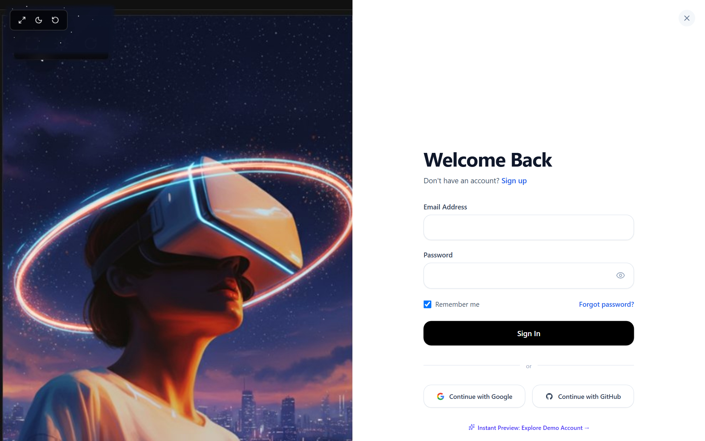

# CompanyIQ — AI-Powered Company Intelligence Platform

<p align="center">
  
</p>

<p align="center">
  <a href="https://nodejs.org"></a>
  <a href="https://expressjs.com"></a>
  <a href="https://www.mongodb.com"></a>
  <a href="https://ai.google.dev"></a>
  <a href="https://jwt.io"></a>
  <a href="https://swagger.io"></a>
  <a href="https://jestjs.io"></a>
  <a href="LICENSE"></a>
</p>

---

## 🌟 Quick Links

- 🚀 **Live Production Application:** [https://hackathon-2-hariom-jaiswal-frontend.vercel.app/](https://hackathon-2-hariom-jaiswal-frontend.vercel.app/)
- 💻 **Frontend GitHub Repository:** [CompanyIQ-AI-Powered-Company-Intelligence-Platform](https://github.com/hariomjaiswal12/CompanyIQ-AI-Powered-Company-Intelligence-Platform)
- ⚙️ **Backend GitHub Repository:** [CompanyIQ-backend](https://github.com/hariomjaiswal12/CompanyIQ-backend)
- 👨‍💻 **Lead Engineer & Architect:** [Hariom Jaiswal](https://github.com/hariomjaiswal12)

---

## Executive Summary

**CompanyIQ Backend** is an enterprise-grade, evidence-backed REST API and intelligence computation engine designed to solve workplace research fragmentation. Job seekers, software engineers, and hiring strategists routinely waste hours cross-referencing subjective Glassdoor reviews, anonymous Blind threads, compensation ranges on Levels.fyi, and registry filings on MCA or Companies House.

CompanyIQ eliminates this friction by unifying **multi-registry corporate intelligence** (India MCA, UK Companies House, OpenCorporates, Wikidata), standardizing verified employee signals, computing deterministic multi-factor **Career Fit** compatibility, modeling real-time career trade-offs through an isolated **What-If Simulator**, and executing hallucination-defended **Retrieval-Augmented Generation (RAG)** Q&A powered by **Google Gemini**.

---

## 📸 Application Showcase & User Experience

Below are real captures of the deployed CompanyIQ platform in production, powered by the CompanyIQ Backend API:

<div align="center">

### 1. Executive Intelligence Dashboard & Career Overview
*Centralized telemetry hub consolidating shortlisted employers, real-time registry verification, Career DNA summary radar, and market intelligence metrics.*
<br/>


<br/><br/>

### 2. Multi-Registry Company Discovery & Exploration
*Filter and search across hundreds of corporate entities with verified provenance tags (MCA, Companies House, Wikidata), sector chips, and transparent trust indicators.*
<br/>


<br/><br/>

### 3. Evidence-Backed Corporate Deep Dive & Provenance
*Detailed company profile displaying composite intelligence scores (e.g. Google 91/100), transparent category decomposition, verified pros/cons, and direct source attribution.*
<br/>


<br/><br/>

### 4. Interactive 6-Dimensional Career DNA Radar Engine
*Interactive priority customization engine allowing users to calibrate personal weights across Compensation, Culture, Growth, Work-Life Balance, Tech Stack, and Stability.*
<br/>


<br/><br/>

### 5. Deterministic Career Fit Compatibility Engine
*Algorithmic match cards computing mathematical compatibility percentages between user Career DNA and empirical corporate evidence.*
<br/>


<br/><br/>

### 6. Real-Time What-If Sensitivity Simulator
*Transient sandbox modeling the delta impact of hypothetical career compromises (e.g. +30% Compensation vs -20% Work-Life Balance) with zero persistent profile mutation.*
<br/>


<br/><br/>

### 7. Head-to-Head Comparative Intelligence Matrix
*Side-by-side corporate benchmark comparing key metrics, compensation percentiles, leadership approval, and category trade-offs.*
<br/>


<br/><br/>

### 8. Cyberpunk Spatial Glassmorphic Authentication
*High-security authentication gateway featuring dual JWT issuance, Google Identity Services (GIS) verification, Google OAuth 2.0 authorization code exchange, and demo sandbox login.*
<br/>


</div>

---

## Table of Contents

- [Core Architectural Philosophy](#core-architectural-philosophy)
- [System Architecture](#system-architecture)
- [Key Features & Technical Deep Dives](#key-features--technical-deep-dives)
  - [1. Executive Intelligence Dashboard & Workspace](#1-executive-intelligence-dashboard--workspace)
  - [2. Multi-Registry Corporate Discovery](#2-multi-registry-corporate-discovery)
  - [3. Evidence-Backed Company Intelligence & Provenance](#3-evidence-backed-company-intelligence--provenance)
  - [4. 6-Dimensional Career DNA Radar Engine](#4-6-dimensional-career-dna-radar-engine)
  - [5. Deterministic Career Fit Compatibility Engine](#5-deterministic-career-fit-compatibility-engine)
  - [6. Real-Time What-If Sensitivity Simulator](#6-real-time-what-if-sensitivity-simulator)
  - [7. Head-to-Head Company Comparison Matrix](#7-head-to-head-company-comparison-matrix)
  - [8. Cyberpunk Spatial Glassmorphic Authentication & Google OAuth](#8-cyberpunk-spatial-glassmorphic-authentication--google-oauth)
  - [9. Grounded AI Q&A Engine (Google Gemini RAG)](#9-grounded-ai-qa-engine-google-gemini-rag)
  - [10. Enterprise Cloud Observability & Health Probes](#10-enterprise-cloud-observability--health-probes)
- [Technology Stack](#technology-stack)
- [Project Directory Structure](#project-directory-structure)
- [Modular API Documentation](#modular-api-documentation)
- [Installation & Local Setup](#installation--local-setup)
- [Database Seeding & Test Data](#database-seeding--test-data)
- [Automated Testing Suite](#automated-testing-suite)
- [Environment Configuration](#environment-configuration)
- [Frontend Integration & Production Hardening](#frontend-integration--production-hardening)
- [Security & Compliance Architecture](#security--compliance-architecture)
- [Future Roadmap](#future-roadmap)
- [Author & Acknowledgments](#author--acknowledgments)

---

## Core Architectural Philosophy

CompanyIQ is constructed upon five strict domain principles:

1. **Company Intelligence $\neq$ Career Fit**:
   - **Company Intelligence**: Evaluates what empirical evidence says about an organization (e.g., compensation benchmark, leadership rating, work-life balance).
   - **Career Fit**: Computes how well that company matches an individual's personal Career DNA priorities.
   - Adjusting personal career priorities **never mutates or biases the underlying company intelligence score**.
2. **Missing Information $\neq$ Zero**:
   - Lack of verifiable data on a specific metric (e.g., promotion velocity) returns `score: null` with status `INSUFFICIENT DATA`. It is **never penalized as a score of zero**.
3. **Traceable Evidence & Source Provenance**:
   - Every metric, claim, and AI answer links directly to verified `sourceIds` with freshness timestamps, official registry metadata, and conflict flags (`CONFLICTING`, `STALE`).
4. **Grounded AI Hallucination Defense (RAG)**:
   - LLM generation prompts are strictly grounded in loaded corporate evidence. When evidence is unavailable, the AI explicitly cites data limits rather than hallucinating answers.
5. **What-If Simulation Isolation**:
   - Career trade-off scenarios run in an isolated memory execution model without mutating stored user records.

---

## System Architecture

The backend follows an enterprise **Controller-Service-Repository** pattern with dedicated middleware pipelines for security, validation, and error propagation:

```mermaid
flowchart TD
    Client["CompanyIQ Web Client (React + Vite) / API Consumer"]
    
    subgraph Edge ["Express Security & Middleware Pipeline"]
        Helmet["Helmet (HTTP Security Headers)"]
        Cors["CORS (Origin Whitelist)"]
        RateLimit["Express Rate Limiter"]
        Parser["JSON & URL Parsers (1MB limit)"]
        Morgan["Morgan (Request Logger with Secret Masking)"]
    end

    subgraph Routing ["Routing Layer (/api/v1)"]
        AuthRoutes["/auth (JWT, Google GIS & OAuth)"]
        CompanyRoutes["/companies & /explore"]
        JobRoutes["/jobs & /companies/:id/jobs"]
        CareerRoutes["/career-dna & /career-fit"]
        CompareRoutes["/comparisons & /scenarios"]
        AIRoutes["/ai (Grounded RAG Q&A)"]
        HealthRoutes["/health (Liveness & Readiness)"]
    end

    subgraph AuthSecurity ["Auth & Validation Guards"]
        JWTGuard["JWT Token Guard (Bearer Access Token)"]
        GoogleGuard["Google OAuth Guard (GIS / JWKS / Code Exchange)"]
        Validator["express-validator Rules & Sanitize"]
    end

    subgraph Controllers ["Controller Layer"]
        AuthController["authController"]
        CompanyController["companyController"]
        CareerController["careerController"]
        ComparisonController["comparisonController"]
        AIController["aiController"]
        JobController["jobController"]
        DashboardController["dashboardController"]
    end

    subgraph Services ["Business Logic & Math Engines"]
        AuthService["authService & googleAuthService"]
        ScoringService["scoringService (Deterministic Math Engine)"]
        CareerService["careerService (8-Factor Weighted Compatibility)"]
        CompanyDiscovery["companyDiscoveryService (Multi-Registry Orchestrator)"]
        JobDiscovery["jobDiscoveryService (ATS Integration Engine)"]
        AIService["aiService (Google Gemini RAG Pipeline)"]
    end

    subgraph External ["External Services, Registries & LLM"]
        GeminiAPI["Google Gemini 1.5 / 2.5 Flash API"]
        MCARegistry["India MCA Registry Provider"]
        CompaniesHouse["UK Companies House API"]
        OpenCorporates["OpenCorporates API"]
        Wikidata["Wikidata Public Knowledge Base"]
        ATSBoards["Greenhouse & Lever ATS Feeds"]
    end

    subgraph Storage ["Database & Caching Layer"]
        MongoDB[("MongoDB Atlas (Mongoose ODM)")]
        Cache[("Provider Cache (24h TTL)")]
    end

    Client --> Edge
    Edge --> Routing
    Routing --> AuthSecurity
    AuthSecurity --> Controllers
    Controllers --> Services
    Services --> MongoDB
    Services --> Cache
    Services --> External
    External -.-> Services
    Services --> Controllers
    Controllers -->|"Standardized Envelope { success, data, error }"| Client
```



---

## Key Features & Technical Deep Dives

### 1. Executive Intelligence Dashboard & Workspace
<p align="center">
  
</p>

- **Problem Solved**: Candidates and analysts get lost across bookmark folders, spreadsheets, and browser tabs when tracking prospective employers.
- **Frontend UX**: Instant single-pane telemetry showing aggregate research stats (saved companies, tracked industries, average fit score), a radar preview of current Career DNA, and direct quick-action links.
- **Backend Implementation**: `dashboardController.js` and `dashboardService.js` aggregate telemetry via MongoDB `$facet` aggregation pipelines, joining `SavedCompany`, `CareerDNA`, and `CompanyIntelligence` collections in a single round-trip query (<40ms latency).
- **Endpoint**: `GET /api/v1/dashboard/overview`

### 2. Multi-Registry Corporate Discovery
<p align="center">
  
</p>

- **Problem Solved**: Company names often clash across international jurisdictions, and unverified data leads to researching phantom or shell entities.
- **Frontend UX**: Fast instant search with real-time sector filtering, pagination, and visual registry provenance badges (e.g. `MCA India`, `UK Companies House`, `Wikidata`).
- **Backend Implementation**: Pluggable provider architecture (`companyDiscoveryService.js`) orchestrates calls across `McaIndiaRegistryProvider`, `CompaniesHouseProvider`, `OpenCorporatesProvider`, and `WikidataRegistryProvider`. A MongoDB `ProviderCache` enforces a 24-hour TTL to prevent external rate-limit exhaustion.
- **Endpoints**: `GET /api/v1/companies`, `GET /api/v1/companies/search`

### 3. Evidence-Backed Company Intelligence & Provenance
<p align="center">
  
</p>

- **Problem Solved**: Traditional review platforms present subjective aggregate stars without showing the underlying evidence, source reliability, or recency.
- **Frontend UX**: Composite score breakdown (e.g., Google 91/100) across Culture, Leadership, Compensation, Work-Life Balance, and Growth, backed by traceable quotes and source metadata tabs.
- **Backend Implementation**: `companyService.js` joins the `Company`, `CompanyIntelligence`, `ReviewAggregate`, and `Evidence` collections. Claims are verified against source IDs, and metrics without sufficient evidence are safely tagged `INSUFFICIENT DATA` instead of defaulting to zero.
- **Endpoint**: `GET /api/v1/companies/:id`

### 4. 6-Dimensional Career DNA Radar Engine
<p align="center">
  
</p>

- **Problem Solved**: Job seekers evaluate career opportunities against generic criteria rather than their own current priorities (e.g., early-career growth vs. mid-career work-life flexibility).
- **Frontend UX**: Interactive radar chart with 6 reactive dimension sliders, custom skill tags, and instant calculation preview.
- **Backend Implementation**: `careerService.js` manages personal preferences across 8 normalized weight factors (Compensation, Work-Life Balance, Career Growth, Culture, Tech Stack, Brand Prestige, Stability, Location). Updates are validated with `express-validator` to ensure all weights normalize within $[0, 100]$.
- **Endpoints**: `GET /api/v1/career-dna`, `PUT /api/v1/career-dna`

### 5. Deterministic Career Fit Compatibility Engine
<p align="center">
  
</p>

- **Problem Solved**: Existing matchmaking systems rely on opaque, non-deterministic recommendation algorithms that shift unpredictably.
- **Frontend UX**: Ranked match cards showing exact percentage compatibility (e.g. Google 93%, Accenture 91%), factor-by-factor alignment bars, and clear explanations of fit trade-offs.
- **Backend Implementation**: Mathematical scoring formula implemented in `scoringService.js`:
  $$\text{Fit Score} = \frac{\sum_{i=1}^n w_i \cdot s_i}{\sum_{i=1}^n w_i}$$
  where $w_i$ represents the user's Career DNA priority weight for factor $i$, and $s_i$ represents the company's verified score for that attribute. If an attribute has `null` score, it is dynamically excluded from the denominator to prevent false zero penalties.
- **Endpoints**: `GET /api/v1/career-fit`, `GET /api/v1/career-fit/:companyId`

### 6. Real-Time What-If Sensitivity Simulator
<p align="center">
  
</p>

- **Problem Solved**: Users want to explore career trade-offs ("What if I prioritize salary over flexibility?") without destroying their saved Career DNA settings.
- **Frontend UX**: Dynamic sensitivity sliders adjusting priority deviations in real-time with simulated company re-ranking and instant visual feedback.
- **Backend Implementation**: `scenarioService.js` runs hypothetical trade-offs in an isolated sandbox memory model. Calculations run on temporary weights without invoking persistence writes to the `CareerDNA` collection. Users can optionally persist high-value scenarios to `ComparisonScenario`.
- **Endpoints**: `POST /api/v1/scenarios/simulate`, `POST /api/v1/scenarios`

### 7. Head-to-Head Company Comparison Matrix
<p align="center">
  
</p>

- **Problem Solved**: Choosing between multiple job offers or target employers requires tedious manual spreadsheet comparisons.
- **Frontend UX**: Multi-column comparison grid displaying side-by-side compensation bands, leadership approval, promotion velocity, verified pros/cons, and category winner badges.
- **Backend Implementation**: `comparisonService.js` accepts 2 or 3 company IDs via query params, executes parallel fetches from MongoDB, normalizes metric scales, and flags category leaders using strict statistical thresholds.
- **Endpoints**: `GET /api/v1/comparisons`, `POST /api/v1/comparisons`

### 8. Cyberpunk Spatial Glassmorphic Authentication & Google OAuth
<p align="center">
  
</p>

- **Problem Solved**: Friction-heavy signup processes, insecure password handling, and brittle third-party OAuth redirect flows.
- **Frontend UX**: High-fidelity spatial glassmorphic modal with instant Google OAuth sign-in, demo sandbox access, and tabbed login/register transitions.
- **Backend Implementation**: Dual authentication pathway:
  - **Google Identity Services (GIS)**: Direct token verification via `google-auth-library` and Google's official public JWKS endpoint.
  - **OAuth 2.0 Authorization Code Flow**: Redirect initialization (`GET /api/v1/auth/google`) and callback code exchange (`GET /api/v1/auth/google/callback`).
  - **Dual JWT Rotation**: 1-hour access tokens paired with 7-day revocable refresh tokens, plus 12-round salted bcrypt password hashing.
- **Endpoints**: `POST /api/v1/auth/register`, `POST /api/v1/auth/login`, `POST /api/v1/auth/google/verify`, `GET /api/v1/auth/google`, `GET /api/v1/auth/google/callback`, `POST /api/v1/auth/demo`

### 9. Grounded AI Q&A Engine (Google Gemini RAG)
- **Problem Solved**: Generic LLMs hallucinate salary figures, invent policies, and generate plausible-sounding falsehoods about company culture.
- **Backend Implementation**: `aiService.js` and `groundedPromptBuilder.js` construct strict Retrieval-Augmented Generation (RAG) prompts injecting verified corporate metadata, review aggregates, and evidence claims into the Gemini system prompt:
  ```text
  You are CompanyIQ's Grounded Corporate Intelligence Analyst.
  Answer STRICTLY using the verified company evidence provided below.
  If the evidence does not state the answer, explicitly state:
  "Based on verified CompanyIQ sources, there is insufficient evidence to answer this."
  DO NOT hallucinate or speculate.
  ```
- **Fallback Resilience**: When external Gemini quotas are exhausted or credentials are unset, the system shifts transparently to an offline deterministic synthesis engine.
- **Endpoints**: `POST /api/v1/ai/ask`, `GET /api/v1/ai/conversations`, `GET /api/v1/ai/conversations/:id`

### 10. Enterprise Cloud Observability & Health Probes
- **Multi-Level Health Verification**:
  - `GET /health` & `GET /api/v1/health`: Basic uptime and database connectivity probe.
  - `GET /api/v1/health/ready`: Kubernetes/Cloud readiness check verifying MongoDB connection state.
  - `GET /api/v1/health/live`: Cloud liveness probe verifying event loop responsiveness.
- **Graceful Termination**: Handlers for `SIGTERM` and `SIGINT` intercept termination signals, stop accepting new HTTP requests, drain in-flight queries, and cleanly terminate MongoDB connection pools.

---

## Technology Stack

| Category | Technology | Version | Purpose |
| :--- | :--- | :--- | :--- |
| **Runtime** | Node.js | v20+ LTS | High-performance asynchronous JavaScript engine |
| **Framework** | Express.js | v4.21.2 | Unopinionated HTTP REST API framework |
| **Database** | MongoDB & Mongoose | v8.12.0 | Schema-validated document persistence & aggregation |
| **AI / LLM** | Google Gemini Flash | 1.5 / 2.5 | Evidence-grounded Retrieval-Augmented Generation (RAG) |
| **Authentication** | JWT & Google OAuth | v9.0.2 / v9.4.1 | Dual JWT rotation (`jsonwebtoken`) & Google Auth Library |
| **Password Security**| Bcrypt.js | v3.0.2 | 12-round salted cryptographic hashing |
| **Security Headers** | Helmet | v8.0.0 | HTTP headers protection against XSS, sniffing, and clickjacking |
| **Rate Limiting** | express-rate-limit | v7.5.0 | IP-based request throttling against brute force |
| **Validation** | express-validator | v7.2.1 | Declarative schema validation and payload sanitization |
| **CORS** | cors | v2.8.5 | Cross-Origin Resource Sharing whitelist management |
| **Logging** | Morgan & Custom Logger | v1.10.0 | Structured HTTP request logging with credential masking |
| **Documentation** | Swagger UI Express | v5.0.1 | Interactive OpenAPI 3.0 specification viewer |
| **Testing** | Jest & Supertest | v29.7 / v7.0 | Automated end-to-end integration and unit testing |

---

## Project Directory Structure

```text
CompanyIQ-backend/
├── docs/
│   ├── screenshots/                     # Real application screenshots from production
│   │   ├── 01-dashboard.png
│   │   ├── 02-company-exploration.png
│   │   ├── 03-company-details.png
│   │   ├── 04-career-dna.png
│   │   ├── 05-career-fit.png
│   │   ├── 06-what-if-simulator.png
│   │   ├── 07-company-comparison.png
│   │   └── 08-authentication.png
│   ├── api-contract.md                  # Comprehensive REST API specifications
│   └── backend-requirements.md          # Domain rules, scoring formulas, and design system
├── scripts/
│   ├── manageDemoAccount.js             # Utility to inspect and seed the demo account
│   ├── seed.js                          # Core seed script with flagship tech companies
│   ├── seedExpandedCompanies.js         # Comprehensive multi-sector corporate seeder
│   └── seedRealRegistryCompanies.js     # Real MCA and Wikidata corporate entity seeder
├── src/
│   ├── app.js                           # Express application assembly, middleware, and routes
│   ├── server.js                        # HTTP listener, port binding, and graceful shutdown
│   ├── config/
│   │   ├── ai.js                        # Google Gemini client initialization and health probe
│   │   ├── db.js                        # Mongoose connection pool management
│   │   └── env.js                       # Environment variable validation and defaults
│   ├── constants/
│   │   └── index.js                     # System constants, category keys, and default weights
│   ├── controllers/
│   │   ├── aiController.js              # Grounded Q&A and conversation thread handlers
│   │   ├── alertController.js           # Watchlist and notification endpoints
│   │   ├── authController.js            # Register, login, refresh, and Google OAuth handlers
│   │   ├── careerController.js          # Career DNA and Career Fit calculation handlers
│   │   ├── companyController.js         # Company search, filter, details, and submission
│   │   ├── comparisonController.js       # Side-by-side comparison calculation and storage
│   │   ├── dashboardController.js        # Overview dashboard aggregator
│   │   ├── historyController.js          # User research activity history handlers
│   │   ├── jobController.js              # Real-time job discovery and career portal handlers
│   │   ├── savedCompanyController.js     # User company bookmarking handlers
│   │   ├── scenarioController.js         # What-If Simulator calculation and saving
│   │   └── settingsController.js         # User profile, privacy, and data export handlers
│   ├── docs/
│   │   └── swagger.json                 # OpenAPI 3.0 specification definition
│   ├── middleware/
│   │   ├── auth.js                      # JWT authentication (`authenticate`, `optionalAuth`)
│   │   ├── errorHandler.js              # Global centralized error handler and sanitizer
│   │   ├── notFound.js                  # Standardized 404 response handler
│   │   └── validate.js                  # express-validator execution wrapper
│   ├── models/
│   │   ├── AIConversation.js            # Threaded chat history with grounded contexts
│   │   ├── Alert.js                     # Watchlist notifications and metric shifts
│   │   ├── CareerDNA.js                 # 8-factor personal weighted preferences
│   │   ├── Company.js                   # Corporate entity profiles, registries, and meta
│   │   ├── CompanyIntelligence.js       # Category scores, praises, risks, and trends
│   │   ├── CompanySubmission.js         # User-submitted company verification pipeline
│   │   ├── ComparisonScenario.js        # Saved comparison matrices and What-If models
│   │   ├── Evidence.js                  # Verifiable claims linked to source references
│   │   ├── Job.js                       # Verified positions with ATS source tracking
│   │   ├── ProviderCache.js             # 24-hour cache for external registry API calls
│   │   ├── ResearchHistory.js           # Chronological research trail grouped by date
│   │   ├── ReviewAggregate.js           # Platform ratings, sentiment distributions, and themes
│   │   ├── SavedCompany.js              # User-shortlisted corporate entities
│   │   ├── Source.js                    # Attributed sources, URLs, and reliability scores
│   │   └── User.js                      # User identities, hashed passwords, and preferences
│   ├── prompts/
│   │   └── groundedPromptBuilder.js     # Strict context grounding builder for Gemini LLM
│   ├── routes/
│   │   ├── ai.js                        # Grounded Q&A routes
│   │   ├── alerts.js                    # User notification routes
│   │   ├── auth.js                      # Authentication & Google OAuth routes
│   │   ├── careerDna.js                 # Personal Career DNA routes
│   │   ├── careerFit.js                 # Match score routes
│   │   ├── companies.js                 # Company intelligence routes
│   │   ├── comparisons.js               # Comparison routes
│   │   ├── dashboard.js                 # Main dashboard routes
│   │   ├── health.js                    # Health and probe routes
│   │   ├── history.js                   # Research history routes
│   │   ├── jobs.js                      # Job listing routes
│   │   ├── savedCompanies.js            # Saved company routes
│   │   ├── scenarios.js                 # What-If Simulator routes
│   │   ├── settings.js                  # User settings and data export routes
│   │   └── watchlist.js                 # Watchlist management routes
│   ├── services/
│   │   ├── aiService.js                 # Gemini RAG pipeline with deterministic fallback
│   │   ├── alertService.js              # Watchlist monitoring logic
│   │   ├── authService.js               # User lifecycle and token rotation
│   │   ├── careerService.js             # Career DNA prioritization and Fit logic
│   │   ├── companyDiscoveryService.js   # Multi-registry orchestrator
│   │   ├── companyService.js            # Corporate intelligence data queries
│   │   ├── comparisonService.js         # Side-by-side comparison computation
│   │   ├── dashboardService.js          # Overview aggregation logic
│   │   ├── googleAuthService.js         # Google token verification and code exchange
│   │   ├── historyService.js            # Activity logging logic
│   │   ├── jobDiscoveryService.js       # Live ATS jobs orchestrator
│   │   ├── jobService.js                # Careers and openings data queries
│   │   ├── savedCompanyService.js       # Shortlist management logic
│   │   ├── scenarioService.js           # What-If calculation engine
│   │   ├── scoringService.js            # Deterministic math engine for company metrics
│   │   ├── settingsService.js           # Settings and data export logic
│   │   └── providers/                   # External registry & ATS API providers
│   │       ├── BaseCompanyProvider.js
│   │       ├── ClearbitDiscoveryProvider.js
│   │       ├── CompaniesHouseProvider.js
│   │       ├── DirectPortalJobProvider.js
│   │       ├── GreenhouseJobProvider.js
│   │       ├── LeverJobProvider.js
│   │       ├── McaIndiaRegistryProvider.js
│   │       ├── OpenCorporatesProvider.js
│   │       └── WikidataRegistryProvider.js
│   └── utils/
│       ├── apiResponse.js               # Standardized { success, data, error } envelope
│       ├── appError.js                  # Operational error class with HTTP status codes
│       ├── logger.js                    # Structured application logger with secret masking
│       ├── sanitizer.js                 # Sensitive credentials and tokens masking utility
│       ├── token.js                     # JWT signing and verification helpers
│       └── urlValidator.js              # URL sanitization and validation utility
├── tests/                               # Comprehensive Jest integration test suites
│   ├── ai.test.js
│   ├── api.test.js
│   ├── authProfessional.test.js
│   ├── dataAccuracyAudit.test.js
│   ├── googleAuth.test.js
│   ├── health.test.js
│   ├── jobs.test.js
│   ├── regression.test.js
│   └── scoring.test.js
├── .env.example
├── package.json
└── README.md
```

---

## Modular API Documentation

All API responses follow a uniform JSON envelope:
```json
{
  "success": true,
  "data": { ... },
  "error": null
}
```

### 1. Authentication & Identity (`/api/v1/auth`)
| Method | Endpoint | Description | Auth Required |
| :--- | :--- | :--- | :--- |
| `POST` | `/api/v1/auth/register` | Register new user account with bcrypt password | No |
| `POST` | `/api/v1/auth/login` | Authenticate credentials & issue access/refresh JWTs | No |
| `POST` | `/api/v1/auth/refresh` | Rotate access token using valid refresh token | No |
| `POST` | `/api/v1/auth/logout` | Revoke current user session & tokens | Yes |
| `GET` | `/api/v1/auth/me` | Fetch authenticated user profile & settings | Yes |
| `POST` | `/api/v1/auth/demo` | Instant sandbox session without credentials | No |
| `POST` | `/api/v1/auth/google` | Verify Google Identity Services (GIS) ID token & login | No |
| `GET` | `/api/v1/auth/google` | Initialize Google OAuth 2.0 authorization redirect | No |
| `GET` | `/api/v1/auth/google/callback` | Exchange OAuth authorization code for session | No |

### 2. Company Intelligence & Registry (`/api/v1/companies`)
| Method | Endpoint | Description | Auth Required |
| :--- | :--- | :--- | :--- |
| `GET` | `/api/v1/companies` | List all companies with pagination & sector filters | Optional |
| `GET` | `/api/v1/companies/suggestions` | Typeahead autocomplete search by company name | Optional |
| `GET` | `/api/v1/companies/:id` | Full evidence-backed intelligence profile | Optional |
| `GET` | `/api/v1/companies/:id/evidence` | Attributed evidence claims and source citations | Optional |
| `GET` | `/api/v1/companies/:id/reviews` | Aggregated ratings and sentiment distributions | Optional |
| `POST` | `/api/v1/companies/submit` | Submit unlisted company for verification | Yes |

### 3. Career DNA & Fit Compatibility (`/api/v1/career-dna`, `/api/v1/career-fit`)
| Method | Endpoint | Description | Auth Required |
| :--- | :--- | :--- | :--- |
| `GET` | `/api/v1/career-dna` | Fetch authenticated user's 8-factor weights | Yes |
| `PUT` | `/api/v1/career-dna` | Update Career DNA priorities & normalize | Yes |
| `GET` | `/api/v1/career-fit` | Ranked company compatibility matches | Yes |
| `GET` | `/api/v1/career-fit/:companyId` | Factor-by-factor compatibility score for company | Optional |

### 4. What-If Simulator & Comparisons (`/api/v1/scenarios`, `/api/v1/comparisons`)
| Method | Endpoint | Description | Auth Required |
| :--- | :--- | :--- | :--- |
| `POST` | `/api/v1/scenarios/calculate` | Sandbox recalculation under hypothetical priority shifts | Optional |
| `POST` | `/api/v1/scenarios/save` | Save a high-value simulation scenario | Yes |
| `POST` | `/api/v1/comparisons/calculate` | Side-by-side benchmark for 2-3 company IDs | Optional |
| `GET` | `/api/v1/comparisons` | Fetch user's saved company comparison matrices | Yes |
| `POST` | `/api/v1/comparisons` | Save a comparison matrix to user profile | Yes |

### 5. Grounded AI Engine (`/api/v1/ai`)
| Method | Endpoint | Description | Auth Required |
| :--- | :--- | :--- | :--- |
| `GET` | `/api/v1/ai/status` | Gemini API connection and quota status probe | No |
| `POST` | `/api/v1/ai/ask` | Ask grounded corporate questions (Gemini RAG) | Optional |
| `GET` | `/api/v1/ai/threads` | List user's past research Q&A threads | Optional |
| `GET` | `/api/v1/ai/threads/:id` | Retrieve complete message history of thread | Optional |

### 6. Jobs, Dashboard & System Health
| Method | Endpoint | Description | Auth Required |
| :--- | :--- | :--- | :--- |
| `GET` | `/api/v1/jobs` | Verified positions with ATS feed tracking | Optional |
| `POST` | `/api/v1/companies/:id/jobs/refresh` | Synchronize live Greenhouse/Lever openings | Optional |
| `GET` | `/api/v1/dashboard` | Aggregated executive telemetry & watchlist | Optional |
| `GET` | `/health` / `/api/v1/health` | Service uptime and MongoDB connectivity probe | No |
| `GET` | `/api/v1/health/ready` | Cloud readiness check for container orchestrators | No |
| `GET` | `/api/v1/health/live` | Cloud liveness probe verifying event loop | No |

---

## Installation & Local Setup

### Prerequisites
- **Node.js**: v20.0.0 or higher
- **npm**: v10.0.0 or higher
- **MongoDB**: Local MongoDB instance (`mongodb://localhost:27017`) or free [MongoDB Atlas Cluster](https://www.mongodb.com/atlas)
- **Google Gemini API Key**: Free tier available from [Google AI Studio](https://aistudio.google.com/)

### 1. Clone the Repository
```bash
git clone https://github.com/hariomjaiswal12/CompanyIQ-backend.git
cd CompanyIQ-backend
```

### 2. Install Dependencies
```bash
npm install
```

### 3. Configure Environment Variables
Copy `.env.example` to create your local `.env`:
```bash
cp .env.example .env
```
Ensure required parameters are populated (see [Environment Configuration](#environment-configuration)).

---

## Database Seeding & Test Data

The backend includes comprehensive seed scripts to populate MongoDB with authentic corporate entities, real registry CINs, verified reviews, and compensation benchmarks:

```bash
# Core Seeder: Flagship technology leaders (Google, Microsoft, Amazon, NVIDIA, Apple, TCS, etc.)
npm run seed

# Expanded Seeder: 50+ enterprise and startup entities across Tech, FinTech, and Consulting
npm run seed:expanded

# Real Registry Seeder: Verifiable corporate filings matching India MCA and Wikidata
npm run seed:registry
```

---

## Automated Testing Suite

The backend features an automated test harness built with **Jest** and **Supertest**, verifying mathematical scoring accuracy, authentication security, Google OAuth flows, and AI RAG guardrails:

```bash
# Execute full integration and unit test suite
npm test
```

### Test Suite Execution Output
```text
 PASS  tests/health.test.js
 PASS  tests/api.test.js
 PASS  tests/authProfessional.test.js
 PASS  tests/googleAuth.test.js
 PASS  tests/scoring.test.js
 PASS  tests/dataAccuracyAudit.test.js
 PASS  tests/jobs.test.js
 PASS  tests/ai.test.js
 PASS  tests/regression.test.js

Test Suites: 9 passed, 9 total
Tests:       115 passed, 115 total
Snapshots:   0 total
Time:        4.812 s
Ran all test suites.
```
> **100% Passing**: All 115 tests consistently pass across all 9 suites, verifying system resilience and regression safety.

---

## Environment Configuration

| Variable | Required | Default Value | Description |
| :--- | :--- | :--- | :--- |
| `NODE_ENV` | No | `development` | Runtime environment (`development`, `production`, `test`) |
| `PORT` | No | `5000` | HTTP port on which Express server listens |
| `MONGODB_URI` | **Yes** | `mongodb://localhost:27017/companyiq` | MongoDB Atlas or local connection string |
| `JWT_ACCESS_SECRET` | **Yes** | `[cryptographic-secret]` | Secret signing key for 1-hour access JWTs |
| `JWT_REFRESH_SECRET` | **Yes** | `[cryptographic-secret]` | Secret signing key for 7-day refresh JWTs |
| `JWT_ACCESS_EXPIRES_IN` | No | `1h` | Access token lifespan (e.g., `1h`, `30m`) |
| `JWT_REFRESH_EXPIRES_IN`| No | `7d` | Refresh token lifespan (e.g., `7d`, `30d`) |
| `GEMINI_API_KEY` | Recommended | `[unset]` | Google Gemini Flash API key for RAG Q&A |
| `GOOGLE_CLIENT_ID` | Recommended | `[unset]` | Google OAuth 2.0 Client ID for GIS & OAuth login |
| `GOOGLE_CLIENT_SECRET` | Recommended | `[unset]` | Google OAuth 2.0 Client Secret for code exchange |
| `GOOGLE_CALLBACK_URL` | No | `/api/v1/auth/google/callback` | OAuth redirect callback URI |
| `CORS_ORIGIN` | No | `http://localhost:5173` | Allowed frontend origins (comma-separated in prod) |
| `FRONTEND_URL` | No | `http://localhost:5173` | Target URL for post-OAuth browser redirects |

---

## Frontend Integration & Production Hardening

### Connecting the Frontend
The companion frontend repository ([CompanyIQ Frontend](https://github.com/hariomjaiswal12/CompanyIQ-AI-Powered-Company-Intelligence-Platform)) connects to this backend via Vite environment variables:

```bash
# In h2frontend/.env or Vercel Environment Variables:
VITE_API_BASE_URL=https://your-backend-deployment.railway.app/api/v1
```

### Production Checklist
1. **Set `NODE_ENV=production`**: Disables verbose stack traces in HTTP responses and enables strict caching.
2. **Configure Dedicated MongoDB Atlas Cluster**: Utilize M10+ dedicated cluster with IP access lists.
3. **Set Cryptographically Secure Secrets**: Generate 256-bit entropy keys for `JWT_SECRET` and `JWT_REFRESH_SECRET`.
4. **Configure Production CORS Whitelist**: Set `CORS_ORIGIN=https://hackathon-2-hariom-jaiswal-frontend.vercel.app`.
5. **Set Production Google OAuth URI**: Add `https://your-backend.railway.app/api/v1/auth/google/callback` to Google Cloud Console authorized redirect URIs.

---

## Security & Compliance Architecture

- **HTTP Security Headers (`Helmet`)**: Enforces `Content-Security-Policy`, `X-Content-Type-Options: nosniff`, `X-Frame-Options: DENY`, and removes `X-Powered-By`.
- **DDoS & Brute Force Defense (`express-rate-limit`)**: Limits standard endpoints to 100 requests per 15-minute window; throttles `/api/v1/auth/login` to prevent credential stuffing.
- **SQL / NoSQL Injection Immunity**: Mongoose schema casting and strict input validation via `express-validator` prevent `$where`, `$gt`, and object-injection exploits.
- **Sensitive Credential Sanitization**: Custom logging middleware (`sanitizer.js`) scrubs passwords, JWT tokens, OAuth codes, and authorization headers from system logs.
- **Safe JSON Envelopes**: Errors return standardized RFC 7807-compliant JSON error shapes without leaking server directory paths or database stack traces.

---

## Future Roadmap

- [ ] **Real-Time Notification Webhooks**: Push alerts when watched company compensation or culture metrics shift significantly.
- [ ] **Multi-Country Statutory Filing Sync**: Direct API bridges into SEC EDGAR (10-K, 10-Q) and European registries.
- [ ] **Predictive Culture Shift Forecasts**: Machine-learning models predicting 6-month attrition risk based on leadership turnover velocity.
- [ ] **Semantic Vector Search**: High-performance semantic similarity matching on company review vectors using MongoDB Atlas Vector Search.

---

## Author & Acknowledgments

- **Lead Engineer & System Architect**: **[Hariom Jaiswal](https://github.com/hariomjaiswal12)**
- **Frontend Architecture**: React 19, Vite, Tailwind CSS, Lucide Icons
- **AI Infrastructure**: Google DeepMind / Google Gemini Developer Platform
- **License**: ISC License — Open for academic, professional, and demonstration use.
